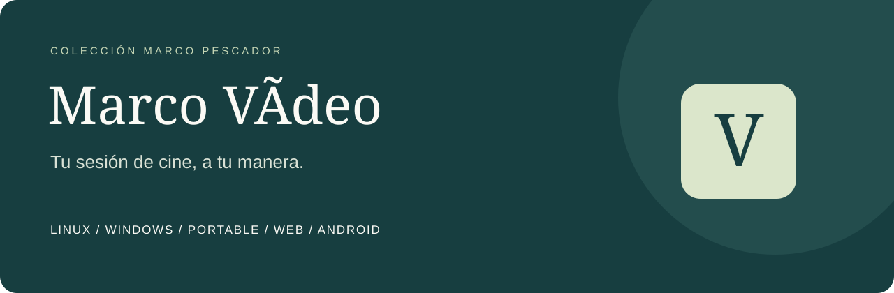
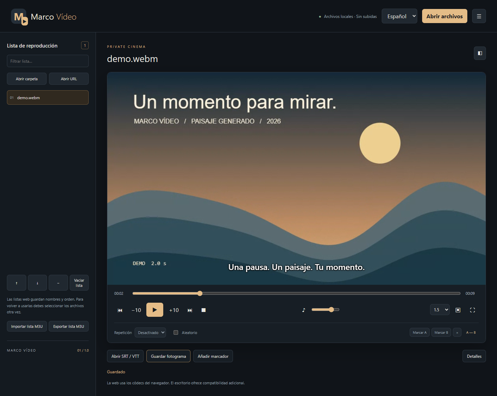

<p align="center"></p>

<p align="center"><b>Reproductor de vídeo y audio local · Español · English · Français</b><br>Windows · Linux · Web · Android</p>

<p align="center"><a href="https://github.com/Peskysa/marco-video/releases/latest">Descargar</a> · <a href="docs/MANUAL.md">Manual</a> · <a href="docs/INSTALACION.md">Instalación</a> · <a href="docs/CAPTURAS.md">Capturas reales</a> · <a href="LICENSE">GPL-3.0</a></p>

Marco Vídeo es un proyecto independiente creado por **Marco Pescador** para reproducir archivos propios, organizar una sesión y controlar imagen, sonido y subtítulos. Sin cuentas, anuncios ni subida de tus vídeos. La interfaz está disponible en español, inglés y francés en todas las variantes.

**[Abrir la versión web](https://marco-video.peskysa.chatgpt.site)** · Alojada con acceso privado para la cuenta del propietario. Para usarla sin Internet, descarga el ZIP web o uno de los portables.



## Descargas

Los archivos compilados están en [Releases](https://github.com/Peskysa/marco-video/releases/latest). El código fuente no sustituye a los ejecutables.

| Variante | Archivo | Instalación / Internet |
| --- | --- | --- |
| Portable Windows x64 | `Marco-Video-Portable.exe` | Un EXE, sin instalar Python, Qt ni códecs adicionales; funciona sin Internet |
| Portable web Windows x64 | `Marco-Video-Web-Portable.exe` | Abre el navegador con un servidor solo local; sin instalación ni Internet |
| Web normal / web en carpeta | `Marco-Video-Web.zip` | Descomprime y abre `index.html`, incluso sin Internet; también se puede alojar por HTTPS |
| Instalador Windows x64 | `Marco-Video-Windows-Instalador.exe` | Instala para tu usuario, sin elevación administrativa |
| Instalador Linux amd64 | `Marco-Video-Linux-amd64.deb` | Debian/Ubuntu compatibles; requiere permisos de instalación y bibliotecas del sistema |
| Android | `Marco-Video-Android.apk` | APK firmado; instalación directa, requiere autorizar esa fuente |

También se ofrece `Marco-Video-Linux-Portable.tar.gz` como alternativa en carpeta para Linux, y `Marco-Video-Documentacion.zip`. Las sumas están en `SHA256SUMS.txt`. Los portables siguen sujetos a las políticas de ejecución del ordenador y extraen componentes temporales; no evitan bloqueos de una organización.

## Funciones

- Abrir varios vídeos o audios, añadir una carpeta, arrastrar archivos y reproducir URL HTTP/HTTPS directas.
- Listas M3U/M3U8, filtro, orden manual, eliminar entradas, siguiente/anterior, aleatorio y repetición de un archivo o toda la lista.
- Pausa, saltos, búsqueda por posición, velocidad de 0,25× a 4×, volumen y silencio.
- Subtítulos externos SRT/WebVTT, UTF-8, UTF-16 y Windows-1252; tamaño y retraso ajustables.
- Reanudar la última posición, marcadores por archivo, capturas PNG del fotograma y temporizador que pausa la reproducción.
- Pantalla completa y modo concentración; controles de teclado y diseño adaptable.
- Escritorio: pistas de audio y subtítulos internos, elección de salida de audio, ventana siempre visible, metadatos y avance de fotograma aproximado.
- Web/Android: giro, encajar/rellenar, brillo, contraste, saturación y ecualizador de tres bandas para archivos locales. Ventana flotante cuando el navegador la admite.

La lista se mantiene durante la sesión; guarda una M3U si quieres conservarla. En web/Android hay que volver a seleccionar los archivos locales al reabrirla, por las reglas de acceso del navegador. La reanudación y los marcadores se guardan localmente, sin sincronización.

## Formatos y límites claros

El escritorio utiliza **Qt Multimedia / FFmpeg**; la compatibilidad depende del códec y la plataforma, no solo de la extensión `.mkv`, `.mp4` o `.avi`. Web y Android usan el motor multimedia del navegador/WebView y admiten menos combinaciones. No se promete reproducir todos los archivos ni 4K fluido en cualquier equipo. [Matriz de funciones y formatos](docs/COMPATIBILIDAD.md).

No incluye descifrado DRM, DVD/Blu-ray, descargas de plataformas, grabación ni conversión de vídeo. Las URL son archivos multimedia accesibles directamente; no páginas de YouTube, listas IPTV/HLS ni servicios con inicio de sesión.

## Documentación

| Guía | Contenido |
| --- | --- |
| [Instalación](docs/INSTALACION.md) | Qué descargar, requisitos, permisos y uso sin Internet |
| [Manual](docs/MANUAL.md) | Reproducción, subtítulos, listas, marcadores y controles |
| [Compatibilidad](docs/COMPATIBILIDAD.md) | Diferencias entre escritorio, web y Android |
| [Privacidad](docs/PRIVACIDAD.md) | Datos locales, URL, memoria de posiciones y borrado |
| [Capturas](docs/CAPTURAS.md) | Imágenes auténticas y cómo reproducirlas |
| [Desarrollo](docs/DESARROLLO.md) | Ejecutar, probar, reconstruir y publicar |
| [Licencia](docs/LICENCIA.md) | Autoría GPL-3.0 y dependencias de terceros |

## Ejecutar desde el código

```powershell
python -m venv .venv
.\.venv\Scripts\python.exe -m pip install -r requirements.txt
.\.venv\Scripts\python.exe player.py
```

La web se prepara con Node.js 24, pnpm 11.25.0 y `python scripts/build.py`, después de instalar las dependencias de `web/`. Consulta la [guía completa](docs/DESARROLLO.md).

## Licencia

Copyright © 2026 Marco Pescador. Código, gráficos originales y demo bajo **GPL-3.0-only**, sin garantía. [Texto completo](LICENSE), [avisos](NOTICE) y [terceros](THIRD_PARTY.md). Qt/PySide, FFmpeg y Capacitor conservan sus licencias. El repositorio comienza privado; para acceder a su código y descargas debes tener acceso a GitHub. La configuración de acceso del alojamiento web es independiente.
