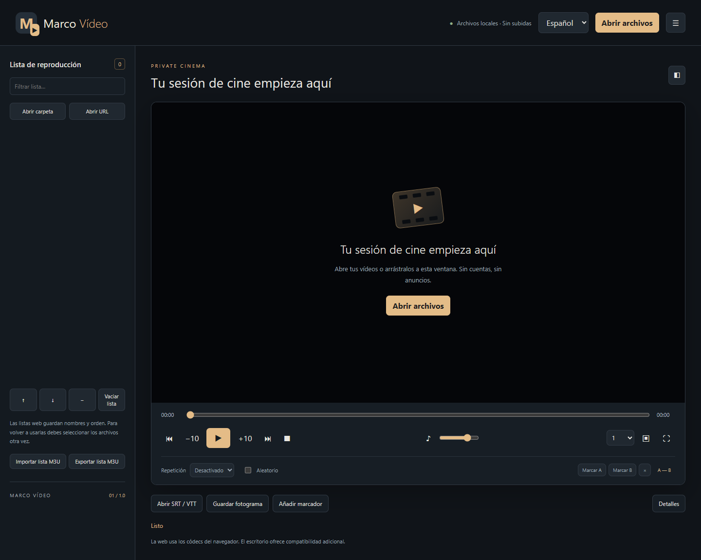
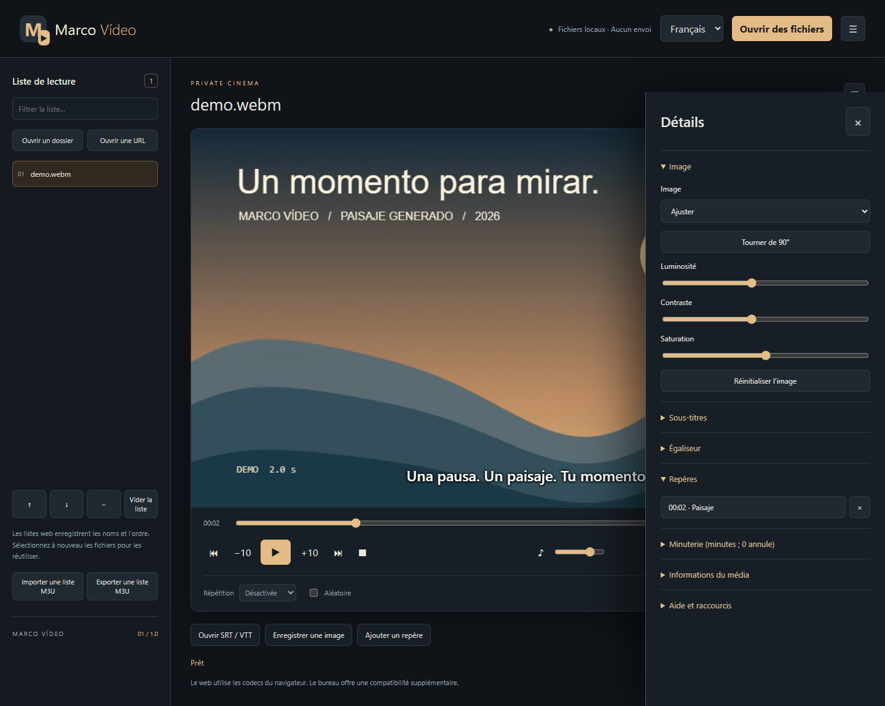
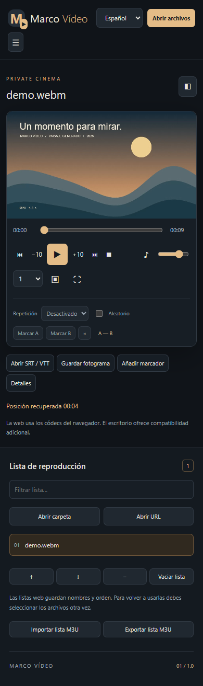
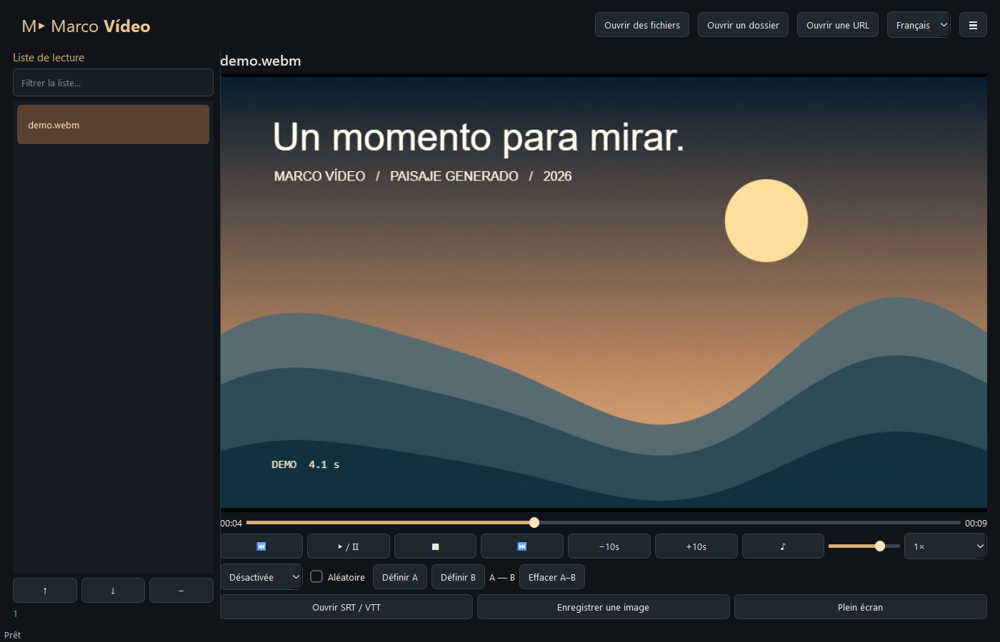

# Capturas reales

[Portada](../README.md)

Estas imágenes se han tomado ejecutando el reproductor. El vídeo mostrado es un paisaje animado creado por código para el proyecto, con un tono de audio sintético y subtítulos ficticios. No contiene películas, datos personales ni fotos de terceros.

## Inicio web

## Vídeo con subtítulos

## Interfaz francesa y marcadores

## Pantalla pequeña

La captura móvil es una ventana del navegador de 390×844 píxeles capturada completa. No es un teléfono físico ni acredita una prueba del APK.

## Escritorio

La ventana nativa se captura desde el escritorio del sistema tras decodificar el vídeo. Los fotogramas se verifican adicionalmente con QVideoSink, porque una captura de widget puede omitir superficies aceleradas.

## Reproducir

Con dependencias instaladas y la web preparada, sirve `dist/web` en `127.0.0.1:5180`. Desde `web/`, ejecuta `node tests/browser.cjs`; `BROWSER_CHANNEL=chromium` permite usar Chromium instalado por Playwright, y el valor predeterminado local es `msedge`. La prueba bloquea todas las peticiones externas, comprueba reproducción/controles y guarda las cuatro capturas web.

Desde la raíz ejecuta `python player.py --self-test test-output/native-report.json`. Guarda el informe, un fotograma y `test-output/escritorio.png`; copia esta última imagen a `docs/images/escritorio.png` tras revisarla. Para regenerar la demo original usa `node tests/make-demo.cjs` desde `web/`.
